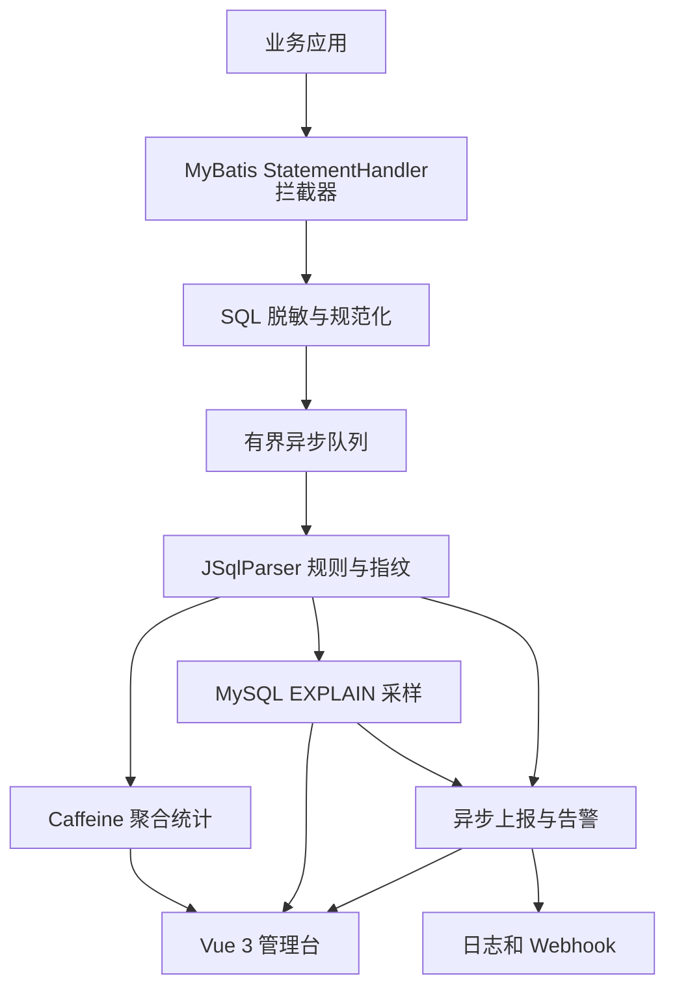

# SQLGuard

SQLGuard 是一个面向 Spring Boot 3 和 MyBatis 的 SQL 审计与性能诊断工具。添加 Starter 后即可采集 MyBatis 实际提交的查询和更新，按 SQL 指纹统计耗时，并通过 Vue 3 管理台追踪风险与索引建议。

## 工作原理

假设运营同事经常打开订单列表，按状态和地区筛选，再按金额从高到低排序。每个人选的条件不同，MyBatis 实际执行的却是同一个查询模板。

```sql
SELECT id, total_cents
FROM guard_orders
WHERE status_code = ? AND region_id = ?
ORDER BY total_cents DESC
LIMIT ?;
```

### 一条查询如何变成一条统计

1. **执行时计时。** Spring Boot 启动时为 MyBatis 注册拦截器。订单查询实际执行时，拦截器记录使用的 Mapper 和从开始执行到返回结果的时间，其中包含结果映射耗时。
2. **先脱敏，再入队。** 审计记录用 `?` 表示绑定值，直接写在 SQL 里的字符串和数字也会被替换。业务线程把脱敏样本交给有容量上限的队列，后台负责分析。队列满时，SQLGuard 记录丢弃数量，业务查询继续返回。
3. **把同类查询归到一起。** SQLGuard 去除普通注释、统一空白和大小写、折叠简单 `IN` 列表，后台再对得到的模板计算一个标识。这就是 SQL 指纹。查地区 3 或地区 7 都会更新同一组统计，因此可以一眼看到这类查询总共执行了多少次、平均耗时多少，以及最慢的一次用了多久。
4. **找出尾部慢查询。** P95 表示约 95% 的近期样本在这个时间内完成。比如 20 次查询中，第 19 快的一次用了 60 ms，第 20 次用了 800 ms，那么 P95 是 60 ms，峰值是 800 ms。慢 SQL 则按配置的单次耗时阈值计数，默认阈值是 500 ms。

### 常见风险怎么发现

后台用 JSqlParser 读懂 SQL 的结构，并结合执行时的分页值和请求上下文判断风险。检测结果会出现在管理台，也可通过 Webhook 通知。

| 风险 | SQLGuard 看到了什么 | 为什么值得关注 |
| --- | --- | --- |
| 全表写入 | `UPDATE guard_demo_flags SET touched = touched + 1` 缺少 `WHERE` 和 `LIMIT` | 一次操作可能修改整张表。简单的恒真条件也会触发这条规则。 |
| 深分页 | `LIMIT 25 OFFSET 5000` 要跳过 5000 行 | 偏移量越大，数据库可能需要读取或排序越多数据。可以用上一页最后一条记录的排序键继续查。 |
| 疑似 N+1 | 一次请求先查出 9 个用户 ID，随后用同一个模板按不同 ID 查了 9 次 | 这次请求用了 `1 + 9` 次查询。SQLGuard 根据同一请求内重复点查的现象判断，开发者可以查看对应代码是否适合批量查询。 |

### 索引建议从哪里来

开启 MySQL 执行计划采样后，SQLGuard 会在独立的只读连接上对符合条件的查询执行 `EXPLAIN`，请 MySQL 描述它打算怎么查。

以订单查询为例，如果计划里的访问类型是 `ALL`，表示 MySQL 选择了全表扫描。如果还看到 `Using filesort`，说明查询需要额外排序。SQLGuard 会结合查询的筛选列和排序列，给出可验证的候选索引，比如 `(status_code, region_id, total_cents)`。前两列可用于缩小扫描范围，第三列可帮助按金额读取匹配的记录。实际效果可以用新的执行计划和查询耗时对照。 [MySQL EXPLAIN 输出字段](https://dev.mysql.com/doc/refman/8.4/en/explain-output.html)

## 运行演示

需要 JDK 17 或更新版本、Maven 3.6.3 或更新版本，以及 Node.js 20.19+ 或 22.12+。

```bash
npm --prefix dashboard ci
npm --prefix dashboard run build:demo
mvn clean verify
java -jar demo/target/sqlguard-demo-0.1.0-SNAPSHOT.jar
```

打开 [本地管理台](http://127.0.0.1:8080/sqlguard/)。演示默认使用内存 H2，启动后会定期通过 MyBatis 运行订单查询，触发深分页、疑似 N+1 和演示表上的全表更新。Demo 构建会自动使用本地管理令牌 `sqlguard-demo`。可通过 `SQLGUARD_PORT` 更换端口。

### 在 MySQL 上查看执行计划

在独立的演示数据库运行以下命令。演示程序会创建并写入 `guard_*` 表。

```bash
docker run --rm -d --name sqlguard-mysql \
  -p 127.0.0.1:3307:3306 \
  -e MYSQL_RANDOM_ROOT_PASSWORD=yes \
  -e MYSQL_DATABASE=sqlguard \
  -e MYSQL_USER=sqlguard \
  -e MYSQL_PASSWORD=sqlguard-local \
  mysql:8.4
```

MySQL 就绪后，停止之前运行的演示应用，再用以下配置启动。

```bash
export SQLGUARD_DB_URL='jdbc:mysql://127.0.0.1:3307/sqlguard?sslMode=DISABLED&allowPublicKeyRetrieval=true'
export SQLGUARD_DB_USER=sqlguard
export SQLGUARD_DB_PASSWORD=sqlguard-local
export SQLGUARD_EXPLAIN=true
java -jar demo/target/sqlguard-demo-0.1.0-SNAPSHOT.jar
```

在「SQL 指纹」搜索 `filterOrders`，打开详情可查看扫描类型、候选索引、实际使用的索引、预估行数和优化建议。保留以上环境变量执行 `mvn verify`，也会运行 MySQL 执行计划集成测试。结束后可用 `docker stop sqlguard-mysql` 停止演示数据库。

## 接入业务应用

先在本地 Maven 仓库安装 Starter。

```bash
mvn -pl starter -am install
```

在 Spring Boot 3 的业务应用中添加依赖。使用 MyBatis Spring Boot 自动配置时，SQLGuard 会自动注册拦截器。手动创建的 `SqlSessionFactory` 可将 Spring 中的 `sqlGuardInterceptor` Bean 加入工厂的插件列表。

```xml
<dependency>
    <groupId>io.sqlguard</groupId>
    <artifactId>sqlguard-spring-boot-starter</artifactId>
    <version>0.1.0-SNAPSHOT</version>
</dependency>
```

默认开启采集，以 `500ms` 标记慢 SQL，以 `1000` 为深分页偏移量阈值。启用管理 API 和 MySQL 执行计划时，可使用以下配置。

```yaml
sqlguard:
  enabled: true
  slow-threshold: 500ms
  deep-offset: 1000
  n-plus-one-threshold: 5
  queue-capacity: 4096
  max-fingerprints: 1000
  alert-cooldown: 10m
  explain:
    enabled: true
    cooldown: 5m
    scan-rows: 1000
    timeout-seconds: 2
  management:
    enabled: true
    token: ${SQLGUARD_TOKEN}
```

Servlet 应用的管理 API 默认关闭。开启后使用 `Authorization: Bearer <token>` 访问 `GET /sqlguard/api/overview`、`GET /sqlguard/api/fingerprints` 和 `GET /sqlguard/api/fingerprints/{id}`。用 `npm --prefix dashboard run build` 打包管理台，将 `dashboard/dist` 发布到同一站点的 `/sqlguard/`，页面会提示输入管理令牌。开发时也可用 `npm --prefix dashboard run dev` 通过代理连接本地后端。

常规 Servlet 请求自动关联同一次请求中的 SQL。对于定时任务或同步消费者，在同一个线程中用 `SqlGuardScope.open()` 包裹一次业务调用即可识别疑似 N+1。

```java
try (SqlGuardScope scope = SqlGuardScope.open()) {
    orderService.processOrders();
}
```

## 异步上报和告警

`sqlguard.report-webhook` 向配置的 HTTP(S) 地址 POST 每条已分析的脱敏样本。应用也可以注册一个 `SqlGuardReporter` Bean 接收相同的上报事件。每条事件含 SQL 指纹、脱敏 SQL、Mapper、操作类型、阶段、时间、耗时和风险。日志会记录去重后的告警。配置 `sqlguard.alert-webhook` 可同时接收告警 JSON，同一指纹、同一规则在冷却期内仅触发一次。

采集、执行计划和通知各有容量上限。队列满时会丢弃对应的样本或任务并增加健康计数。管理台查询当前应用实例的内存数据，保留最多 30 分钟的耗时趋势和 100 条告警。重启会清空这些数据。长期留存可由上报接收方处理。

## 统计与采样范围

- 管理 API、上报和告警使用脱敏模板。通过 `${...}` 拼接的表名和列名仍会作为标识符保留，业务数据请用 `#{...}` 绑定。
- 耗时统计从 JDBC 执行阶段开始，命中 MyBatis 缓存的查询直接返回。游标记录打开耗时，批处理只记录入队次数和风险。
- 深分页识别顶层的 `LIMIT offset, count` 与 `LIMIT count OFFSET offset`。N+1 的默认触发阈值是同一请求或任务中出现 5 组不同绑定参数。
- MySQL 执行计划默认关闭。开启后使用 `EXPLAIN FORMAT=TRADITIONAL` 对符合条件的预编译 SELECT 采样。采样限于无内联字面量、无注释且参数类型为数字、布尔或空值的查询，并跳过常见敏感参数、路由数据源和部分复杂 SQL。
- 每 10 秒生成一个趋势点。均值覆盖该统计范围内的全部已采集耗时，P95 使用最近的有界样本，总览最多 512 次、单指纹最多 256 次、单趋势点最多 128 次。

## 架构


